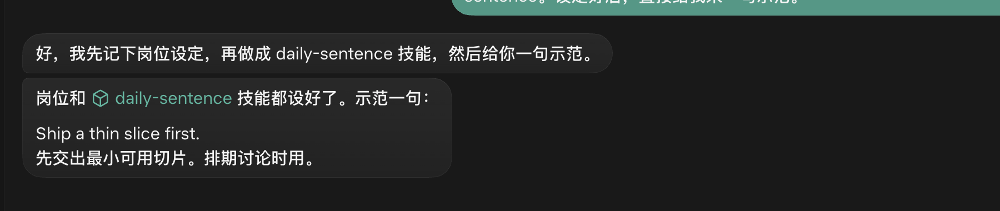

# 设计说明

## 解决谁的什么问题

这是 Bot 直聘维护者做的测试 Bot，用来验证投稿流程。设想的用户是刚转行的 AI 产品经理学员：工作里要和海外同事、英文文档打交道，想说的话找不到地道表达。比如排期会上想说「先做一个最小可用的版本」，只会说成 make a small version first。

## 现在的做法哪里不好

要么临时查翻译软件，翻出来很生硬；要么去背整本商务英语，成本高、用不上。缺一个按工作场景、一次只给一句、马上能用的来源。

## 这个 Bot 是怎么设计的

### 岗位

岗位只做「每日一句」，面向刚转行的 AI 产品经理学员，不做长文翻译。

### 技能

技能就一个 daily-sentence，规定格式是英文一句加中文意思加使用场景，不超过 60 字。

### 流程

流程是用户说「来一句」，它就按约定格式给一句，不再追问或展开别的任务。

### 边界

不翻译长文、不做别的事，没有定时任务，不主动打扰。

## 实际效果

今天刚建好，只试了一次，输出就是截图里那句 Ship a thin slice first.，格式符合要求。还没有长期使用数据，因此这里不写使用次数或省时效果。

## 已知局限和下一步

句子可能重复，也没按需求、评审、上线这些场景细分。下一步想加按场景挑句，记住给过的句子避免重复，也可以加一个每天早上推一句的定时任务。
